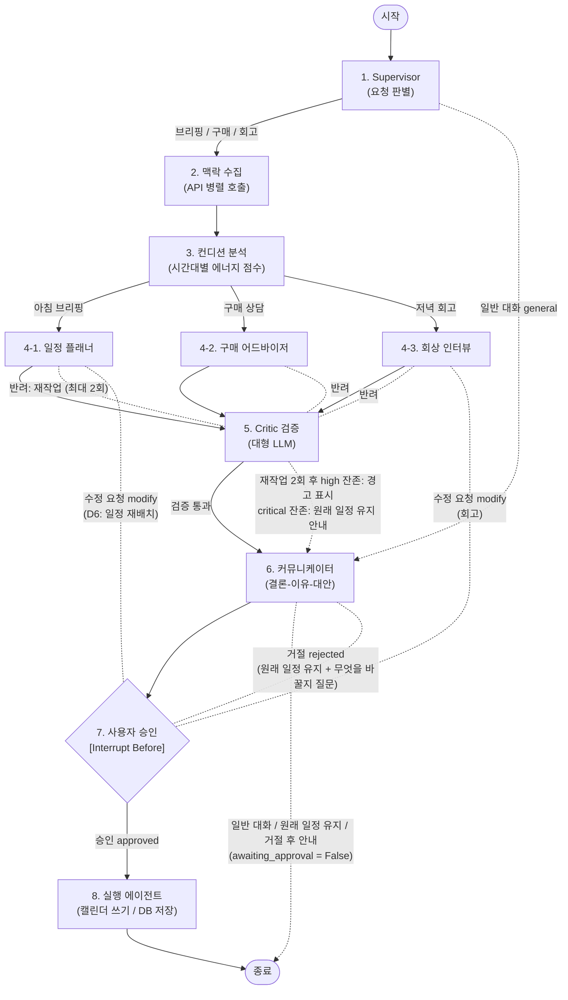

# Personal Agent Core (`personal-agent-core`)

> **개인화 비서 에이전트 프로젝트**의 메인 오케스트레이션 및 LangGraph 코어 레포지토리입니다.  
> 사용자의 컨디션, 일정, 소비 기록을 실제 데이터로 읽고, **"오늘의 나"에게 맞는 시간 사용(일정)과 돈 사용(구매)을 근거와 함께 제안**합니다.

---

## 🎯 서비스 핵심 원칙
1. **근거 있는 추론**: 실제 캘린더, 생체 데이터, 구매 기록 등 외부 실제 데이터와 확인된 패턴만 근거로 활용
2. **목표 우선**: 컨디션은 일의 순서와 분량만 조율하며, 마감 기한 보호 및 후회할 충동 소비 방지
3. **설득력 있는 소통**: 결론 ➔ 이유(데이터 근거) ➔ 대안 순서로 소통하며 거절 시 대안 제시 루프 동작
4. **과잉 개인화 방지**: 관련 없는 기억을 배제하고 답변마다 추론 근거 명시

---

## 🔄 에이전트 워크플로우 (LangGraph Graph Architecture)



> **읽는 법**: 실선(→)은 정상 진행 흐름, 점선(⇢)은 분기·재작업·사용자 피드백 루프입니다.

---

## 📁 프로젝트 구조 (Directory Structure)

```text
personal-agent-core/
├── .env                # 환경 변수 (Git 추적 제외)
├── .env.example        # 환경 변수 템플릿 (Gemini API 키 및 모델 설정)
├── .gitignore          # Git 추적 제외 설정 (.env, DB, PDF 등)
├── README.md           # [본 문서] 프로젝트 아키텍처 및 State 스키마 명세
├── requirements.txt    # 의존성 패키지 목록
├── config.py           # Gemini LLM 설정 (소형 3.8 Flash / 대형 3.1 Pro Preview, v1beta)
├── state.py            # 노드 간 공유되는 공통 AgentState 스키마
├── graph_core.py       # LangGraph 전체 워크플로우 (Supervisor, Critic 루프, Interrupt)
└── db_init.py          # 장기 메모리(SQLite) 테이블 초기화 스크립트
```

---

## 🏗️ 아키텍처 설계 핵심 포인트 (Engineering Highlights)
*본 프로젝트는 단순 텍스트 생성이 아닌, 안정적인 서비스 운영을 위한 **프로덕션 레벨 오케스트레이션 설계**를 적용했습니다.*

1. **계층형 모델 분리 (Cost & Latency Optimization)**:
   * 빠른 응답이 필요한 라우팅(`Supervisor`) 및 데이터 추출에는 **`Gemini 3.8 Flash`**를 적용하여 지연시간과 비용을 최소화했습니다.
   * 깊은 추론과 논리 검증이 필요한 플래너/비평가(`Critic`)에는 **`Gemini 3.1 Pro Preview`**를 배치하여 높은 판단 품질을 확보했습니다.
2. **엄격한 계약 기반 라우팅 (Structured Output Contract)**:
   * LLM의 환각(Hallucination)이나 임의의 문자열 변형으로 인한 조건부 라우팅 오류를 차단하기 위해 **Pydantic 스키마 기반 구조화된 출력**을 강제했습니다.
3. **Human-in-the-Loop & 대안 제시 루프**:
   * AI의 독단적인 일정 변경을 방지하기 위해 `interrupt_before` 기반 승인 단계를 거치며, 사용자가 거절/수정 요청 시 다시 대안을 탐색하는 루프를 지원합니다.
4. **자가 교정(Self-Correction) 메커니즘**:
   * Critic 노드가 마감 기한 누락, 과잉 개인화 등을 감지하면 최대 2회까지 담당 에이전트로 되돌려 스스로 보완하도록 설계되었습니다.

---

## 📜 공통 상태 스키마 명세 (`AgentState`)

모든 에이전트 노드는 `state.py`의 `AgentState`를 공유하며, 필요한 데이터를 읽고 자신의 결과값을 업데이트합니다.

> **사용자 메시지 읽기 규칙**: 사용자 메시지의 원본은 `messages` 하나입니다. 별도 `user_message` 칸을 만들지 말고 `from state import get_last_user_message`로 읽어 주세요.

### 1. `AgentState` 필드 목록

| 필드명 | 타입 | 담당 에이전트 | 설명 및 예시 |
|---|---|---|---|
| `messages` | `Annotated[List[BaseMessage], operator.add]` | 공통 | 대화 히스토리 누적 관리 |
| `request_type` | `str` | Supervisor | 요청 유형 (`morning_briefing`, `purchase_consultation`, `retrospective`, `general`) |
| `context_data` | `Dict[str, Any]` | 맥락 수집 | 외부 API 데이터 (`calendar`, `tasks`, `weather`, `sleep_score`, `spending`) |
| `condition_score` | `Dict[str, Any]` | 컨디션 분석 | 시간대별 에너지 점수 (`{"morning": 80, "afternoon": 40}`) |
| `draft_proposal` | `Dict[str, Any]` | 플래너 / 어드바이저 | 에이전트가 제안하는 작업/구매 초안 (`action`, `target`, `reason`) |
| `is_valid` | `bool` | Critic | 검증 통과 여부 (`True` / `False`) |
| `critic_feedback` | `str` | Critic | 검증 피드백 요약 문장 |
| `critic_result` | `CriticResult` | Critic | **구조화된 검증 상세 결과** (하단 ① 참조) |
| `rework_count` | `int` | Critic | 누적 반려 횟수. 역할 에이전트 재작업 최대 2회(=Critic 검사 최대 3회). modify 시 0으로 초기화 |
| `critic_verdict` | `Literal["rework", "pass", "warn", "keep_original"]` | Critic | **커뮤니케이터가 안내 문구를 고르는 기준.** `pass` 통과 / `warn` 2회 후 high 잔존(경고 표시) / `keep_original` 2회 후 critical 잔존(원래 일정 유지, 승인 없이 종료) / `rework` 그래프 내부용 |
| `final_response` | `str` | 커뮤니케이터 | 사용자에게 전달할 최종 안내 메시지 (결론 ➔ 이유 ➔ 대안) |
| `user_decision` | `UserDecision` | 화면 / 승인 | **사용자의 승인 및 수정 피드백** (하단 ② 참조) |
| `rejected_history` | `Annotated[List[RejectedEntry], operator.add]` | 승인 | 거절·수정 이력 누적, 덮어쓰지 않고 뒤에 추가됨 (D6 검사용, 하단 ③ 참조) |
| `awaiting_approval` | `bool` | 커뮤니케이터 | 응답 뒤 사용자 승인이 필요한지. `False`면 승인 없이 종료 (일반 대화 / 원래 일정 유지 / 거절 후 안내) |

---

### 2. 세부 구조화 타입 명세

#### ① `CriticResult` (검증 결과)
```python
class CriticResult(TypedDict, total=False):
    is_valid: bool                 # 통과 여부 (True/False)
    violated_rules: List[str]      # 위반 규칙 목록 (Critic 조건표 ID 형식, 예: ["A1_마감_누락", "C2_무관한_기억_사용"])
    severity: str                  # 심각도 ("low" | "medium" | "high" | "critical")
    feedback: str                  # 구체적 개선 가이드 문장
    target_agent: Optional[str]    # 재작업 대상 에이전트 ("planner" | "purchase_advisor" | "recall_interview")
```

#### ② `UserDecision` (사용자 승인 결과)
```python
class UserDecision(TypedDict, total=False):
    status: str                    # 결정 상태 ('approved': 승인 | 'rejected': 거절 | 'modify': 수정 요청)
    feedback: Optional[str]        # 거절/대안 요청 시 사용자 추가 코멘트 (예: "3시는 회의가 있어 안 돼")
    decided_at: Optional[str]      # 사용자 결정 일시 (ISO 8601 타임스탬프)
```

#### ③ `RejectedEntry` (거절·수정 이력 한 건)
```python
class RejectedEntry(TypedDict, total=False):
    status: str                    # 'rejected' | 'modify' (승인 approved는 기록하지 않음)
    changes: Any                   # 거절·수정 대상이 된 변경 내용 (일정 플래너: changed_items + postponed_tasks)
    feedback: Optional[str]        # 사용자 피드백
    decided_at: Optional[str]      # 결정 시각 (ISO 8601)
```
> `user_approval` 노드가 거절·수정 요청을 받을 때마다 한 건씩 추가합니다. Critic의 D6 검사는 목록 전체를 참고합니다.
> 수정 요청(modify)의 `feedback`은 `messages`에도 사용자 메시지로 추가되어, 플래너가 `get_last_user_message(state)`로 읽습니다.

---

## 🛠 환경 설정 및 시작 가이드

### 1. 가상환경 생성 및 의존성 설치
```bash
python -m venv venv
# Windows:
.\venv\Scripts\activate
# Mac/Linux:
source venv/bin/activate

pip install -r requirements.txt
```

### 2. 환경 변수 설정 (`.env`)
`.env.example`을 복사하여 `.env`를 생성하고 Gemini API 키를 입력합니다.
```bash
cp .env.example .env
```
```env
GOOGLE_API_KEY="your-gemini-api-key-here"

# 모델 설정 (기본값: 소형 3.8 Flash / 대형 3.1 Pro Preview)
# GEMINI_MODEL_SMALL="gemini-3.8-flash"
# GEMINI_MODEL_LARGE="gemini-3.1-pro-preview"
# GEMINI_API_VERSION="v1beta"   # preview 모델은 v1beta에서만 동작
```

### 3. 장기 메모리(SQLite) 초기화
```bash
python db_init.py
```
> `long_term_memory.db` 파일이 생성되며 `purchase_history`(구매 이력/만족도) 및 `user_patterns`(사용자 패턴) 테이블이 준비됩니다.

---

## 🖥 Streamlit UI 연동 가이드 (검증·소통 담당 참고)

LangGraph의 `MemorySaver` 및 `interrupt_before=["user_approval"]`를 활용하여 UI와 상호작용합니다:

```python
from graph_core import app

# 1. 초기 요청 실행 (user_approval 직전에서 대기)
config = {"configurable": {"thread_id": "user-session-1"}}
state_output = app.invoke({"request_type": "morning_briefing"}, config)

# 2. Streamlit 화면에서 제안 내용 및 근거 패널 렌더링
# state_output["final_response"], state_output["critic_result"] 등 표시

# 3. 사용자가 [승인] 버튼 클릭 시 상태 업데이트 후 재개
#    ⚠️ as_node를 넣지 마세요: 넣으면 user_approval 노드가 건너뛰어져 거절/수정 이력(rejected_history)이 기록되지 않습니다.
app.update_state(config, {"user_decision": {"status": "approved", "feedback": ""}})
final_result = app.invoke(None, config)  # action_executor가 실행되어 캘린더 반영 후 종료

# 4. 사용자가 [수정/거절] 요청 시:
app.update_state(config, {"user_decision": {"status": "modify", "feedback": "3시 일정은 내일로 미뤄줘"}})
app.invoke(None, config)  # modify → 담당 에이전트가 다시 계획 → Critic 재검증 / rejected → "원래 일정 유지 + 무엇을 바꿀지" 안내 후 종료

# 5. 승인 단계 없이 끝나는 경우 (app.get_state(config).next == ())
#    - 일반 대화(general), critic_verdict == "keep_original"(원래 일정 유지), 거절(rejected) 후 안내
#    - 판단 기준: state["awaiting_approval"] == False
#    → final_response만 표시하고 승인 버튼은 숨김
```

---

## 👥 팀 역할 분담 및 산출물 (6인 협업)

| 역할 | 담당 범위 | 필수 산출물 | 협업 담당자 |
|---|---|---|:---:|
| **오케스트레이션 리드** | Supervisor, 공통 State 설계, 장기 메모리(SQLite), 저장소/일정 관리 | 그래프 뼈대 코드, State 스키마 문서 | ⑥ |
| **일정·생체 데이터 연동** | Google Calendar·Tasks API (OAuth), 날씨 API, 생체 데이터 파서 | 각 도구가 실제 데이터를 반환하는 함수 | ④ |
| **구매·지출 데이터 연동** | Gmail 주문 메일 파서, 카드 결제 파서, 캡처 인식 비전 모델, 네이버 쇼핑 API | 본인 실제 구매 10건 이상 DB 저장 | ⑤ |
| **일정 에이전트** | 컨디션 분석, 작업 분류(고정·중요·유연), 재배치, 마감 보호 루프 | 실제 캘린더로 하루 계획을 만드는 노드 | ② |
| **구매 에이전트** | 회상 인터뷰, 기준 도출, 카테고리 관련성 검사, 후보 비교, 보류 분기 | 실제 이력으로 추천/보류를 내는 노드 | ③ |
| **검증·소통·화면** | Critic, 커뮤니케이터, Streamlit 화면, 데모 시나리오 | Critic 프롬프트, 승인 버튼/근거 패널 UI | ① |
